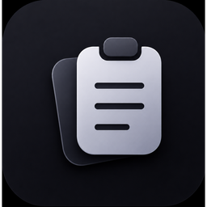

<p align="center">
  
</p>

<h1 align="center">Carbon</h1>

<p align="center">
  <strong>A fast, local-first clipboard manager for Windows.</strong><br/>
  Overlay, searchable history, collections, snippets &amp; offline OCR — everything stays on your machine.
</p>

<p align="center">
  <a href="https://github.com/sanirudh17/Carbon/releases/latest"></a>
  <a href="./LICENSE"></a>
  
  <a href="https://v2.tauri.app/"></a>
</p>

---

## Overview

Carbon is a local-first clipboard manager for Windows. Press a hotkey to summon an overlay anywhere, paste from a searchable history, organize clips into collections, expand snippets system-wide, and extract &amp; search text from images with bundled PP-OCRv6 Small — all without cloud sync, accounts, or telemetry.

Everything lives in a local SQLite database (`carbon_history.db`) with image files on disk in `%APPDATA%\com.carbon.clipboard\`. History, snippets, collections, and settings never leave your computer.

> **New here?** Install `Carbon_0.1.21_x64-setup.exe` from [Releases](https://github.com/sanirudh17/Carbon/releases/latest) — no extra dependencies, PP-OCRv6 Small is already bundled.

## Contents

- [Features](#features)
- [How It Works](#how-it-works)
- [Settings Reference](#settings-reference)
- [Download & Install](#download--install)
- [Building from Source](#building-from-source)
- [Tech Stack](#tech-stack)
- [Project Structure](#project-structure)
- [Configuration & Data](#configuration--data)
- [Privacy](#privacy)
- [Troubleshooting](#troubleshooting)
- [License](#license)

## Features

**Capture & History**

- **Automatic capture** of text, code, rich text, images, files, links, email, and color values as you copy — with de-duplication, favorites, and native Windows OLE drag-and-drop.
- **Instant full-text search** powered by SQLite FTS5 across clip text, file paths, extracted image OCR text, and decoded QR payloads — with type filters, source-app filtering, and inline editing.
- **Collections** with custom colors and optional PIN + recovery code; add/remove clips, rename, and color-code. Unlocked collections and memberships are included in JSON backups.
- **Bulk actions** — select multiple clips to favorite, delete, add to collections, or queue for sequential pasting.
- **Pause & Timed Pause** — pause capture from the system tray indefinitely or for 5m / 15m / 1h with live status feedback and automatic resume.

**Overlay & Library**

- **Quick Overlay** (`Ctrl+Shift+Z`) — fixed split-frame overlay with permanent preview pane, `1–9` quick-paste, native Windows Desktop Acrylic translucency (`Glass` or `Solid`), type &amp; app filters, Paste Queue (`Shift+Enter` / `Ctrl+V` advance), and paste transforms (plain text, markdown, JSON, uppercase/lowercase/title, base64, URL encode/decode).
- **Full Library** (`Ctrl+Alt+X`) — searchable history with collections sidebar, syntax-highlighted code previews, rich-text/Markdown rendering, image &amp; video previews, and snippet management.

**Snippets & Expansion**

- Create snippets with keywords (e.g. `/date`), dynamic placeholders (`{date}`, `{time}`, `{clipboard}`, `{selection}`, `{argument}`, `{snippet:Name}`, `{cursor}`), and chained modifiers.
- **One-click Save as Snippet** (`Ctrl+Shift+S` or context menu) turns any text, code, OCR, or QR clip directly into a reusable snippet.
- **System-wide expansion** — type a keyword in any app and it expands inline at native typing speed. Private 256-char in-memory buffer, zero CPU when idle, UIPI-safe in elevated windows. Opt-in via consent.

**Image, Code & Text Tools**

- **Offline OCR &amp; QR** — extract text from image clips locally with bundled PP-OCRv6 Small and ONNX Runtime CPU (using overlapping native-resolution strips for tall screenshots) and decode QR codes automatically. Extracted OCR text and decoded QR payloads are indexed for instant search.
- **Syntax-highlighted code previews** — theme-aware highlighting for TypeScript, JavaScript, Rust, Python, JSON, HTML, CSS, SQL, Shell, and Markdown.
- **Transforms on paste** — choose per-paste from `Ctrl+K` / right-click, or set default plain-text pasting and move-to-top behavior.

**Smart Capture & Privacy**

- **Clipboard privacy compliance** — honors Windows standard clipboard exclusion formats (`ExcludeClipboardContentFromMonitorProcessing`, `CanIncludeInClipboardHistory`, `Clipboard Viewer Ignore`) plus an editable **Ignored apps** list in Settings (pre-populated with common password managers).
- **ClipMerge** — rapid successive copies within a configurable window append to the top clip instead of creating separate entries.
- **URL cleaning** — strip tracking parameters (`utm_*`, `fbclid`, `gclid`, etc.) at capture time.
- **Custom rules** — ordered find/replace (plain text or regex) applied on every capture.
- **Sensitive detection** — opt-in local detection of credit cards (Luhn), API keys, JWTs, and private keys, with masking and auto-expiry after 5 minutes.

**Hotkeys, Theming & Glass Materials**

- Two swappable global shortcuts with atomic unregister/reapply and strict rollback. `Ctrl+Alt` handled via `AltGraph` parity and a `WH_KEYBOARD_LL` hook; conflicts show inline errors and notifications.
- **System, Light &amp; Dark themes** — follow Windows' light/dark mode automatically or pin Dark/Light explicitly, paired with 6 accent swatches + custom color picker, monochrome HugeIcons, and `Glass` (Desktop Acrylic) or `Solid` window material.

### Window Materials

| Material | Look & Behavior | Compatibility |
|---|---|---|
| **Glass** *(Default)* | Native Windows Desktop Acrylic blur-behind with theme-matched tint, DWM rounded corners, and zero-flash warm-window choreography. | Windows 10 (1809+) &amp; Windows 11 (automatic Blur → Solid fallback) |
| **Solid** | Opaque dark or light panels with zero OS compositor blur. | All Windows 10/11 builds &amp; reduced-transparency mode |

**Resilient Fallbacks & Accessibility:**
- **Automatic fallback chain**: If Desktop Acrylic is unsupported on a Windows build, Carbon falls back (`Acrylic` → `Blur` → `Solid`) automatically.
- **Accessibility aware**: When Windows *"Transparency effects"* are off (`prefers-reduced-transparency: reduce`), Carbon automatically switches to opaque panels.
- **Always warm**: Hidden windows stay warm in memory with DWM cloaking and frame-gated reveals so hotkey invocation is instant with no white flash.

## How It Works

```
  copy (Ctrl+C / right-click)
        │
        ▼
  clipboard watcher ───────► honor privacy formats & ignored apps
        │                    classify (text/code/image/file/link/email/color/rich)
        │                    decode QR, de-duplicate, apply ClipMerge window
        ▼
  smart capture ───────────► strip tracking params → custom rules (regex/text)
        │                    detect sensitive → mask + expires_at (+5m) if enabled
        ▼
  storage ─────────────────► SQLite (WAL + FTS5 incl. OCR/QR) + media/ on disk
        │                    trim by retention_days / max_entries (hourly + on save)
        ▼
  overlay / library ───────► search, filter, favorite, edit, save as snippet, queue
        │
        ▼
  paste ───────────────────► paste_clip / queue_paste_next with PasteTransform
                             (plain/markdown/json/case/base64/url) + bump-to-top
```

## Settings Reference

- **Shortcuts** — Quick overlay (`Ctrl+Shift+Z`) · Library window (`Ctrl+Alt+X`).
- **Behavior** — Start with Windows · Move pasted clip to top · Deselect after paste (web inputs) · ClipMerge + window (`500–10000 ms`).
- **Snippets** — Inline snippet expansion (consent-gated, `WH_KEYBOARD_LL`) · Show snippets.
- **Capture Rules** — Strip URL tracking parameters · Find &amp; Replace rules (plain/regex, ordered).
- **Privacy** — Auto-expire sensitive clips · Ignored apps list (add/remove `.exe` names).
- **Storage** — Retention (`0` = forever) · Max entries · Image size limit (`0` = unlimited) · Clear history · Export / Restore JSON backup (history, images, snippets, and unlocked collections).
- **Updates** — Automatic background update check + on-demand check &amp; signed installer update.
- **Appearance** — Reduced picker animation · Accent color (6 swatches + custom picker) · Theme (`System`, `Light`, `Dark`) · Window material (`Glass`, `Solid`).

## Download & Install

Download the latest installer from the [**Releases**](https://github.com/sanirudh17/Carbon/releases/latest) page and run it:

| Installer | Notes |
|---|---|
| **`Carbon_0.1.21_x64-setup.exe`** | NSIS installer — single executable, bundles PP-OCRv6 Small &amp; ONNX Runtime CPU. |

Everything Carbon needs is bundled — no extra dependencies. The installer is currently unsigned, so Windows SmartScreen may show *“Windows protected your PC”* → **More info → Run anyway**.

**System requirements:** Windows 10 or 11 (64-bit). WebView2 is preinstalled on Windows 11 and auto-installed on Windows 10 if missing.

## Building from Source

### Prerequisites

- [Node.js](https://nodejs.org/) 18+ with npm
- [Rust](https://rustup.rs/) stable toolchain
- [Tauri v2 prerequisites](https://v2.tauri.app/start/prerequisites/) — Microsoft C++ Build Tools + WebView2
- PowerShell (for binary fetch)

### 1. Clone and install

```bash
git clone https://github.com/sanirudh17/Carbon.git
cd Carbon
npm install
```

### 2. Prepare the bundled OCR assets

```bash
npm run prepare:ocr
# Already-cached assets can be verified without network access:
node scripts/prepare-ocr.mjs --offline
```

This fetches pinned PP-OCRv6 Small models and ONNX Runtime CPU resources into `src-tauri/binaries/ocr/`. Sizes and SHA-256 hashes are recorded in `src-tauri/resources/ocr/manifest.json`; required license notices are bundled too. `npm run build` prepares/verifies these files automatically.

### 3. Run in development

```bash
npm run tauri dev
```

### 4. Build the installer

```bash
npm run tauri build
# → src-tauri/target/release/bundle/nsis/Carbon_0.1.21_x64-setup.exe
```

### 5. Run the test suite

```bash
cargo test --manifest-path src-tauri/Cargo.toml --lib
npm test
npm run build
```

## Tech Stack

| Layer | Technology |
|---|---|
| App shell | [Tauri v2](https://v2.tauri.app/) — Rust core + WebView2 |
| Frontend | React 19, TypeScript, Vite, Zustand, HugeIcons |
| Database | SQLite (`rusqlite` bundled, WAL + FTS5) |
| OCR &amp; QR | PP-OCRv6 Small, OAR-OCR 0.10, ONNX Runtime CPU (bundled), `quircs` |
| Hotkeys | `tauri-plugin-global-shortcut` + `WH_KEYBOARD_LL` hook |
| Clipboard | Windows `Win32_System_DataExchange`, OLE drag-and-drop, `html2md`, `image` |

## Project Structure

```
src/               React + TypeScript frontend (Vite)
  components/      QuickOverlay, EnlargedWindow, Settings, ClipPreview, SnippetsView, Icons (HugeIcons)
  lib/             choreo, richText, syntaxHighlight, searchHighlights, accentContrast
  utils/           clipActions, clipDrag, snippets, collections, hotkeys
src-tauri/
  src/             Rust core (clipboard_watcher, db, hotkey, shortcuts, expansion, ocr, paste, native_drag, vibrancy, settings)
  icons/           App icons (128x128@2x, icon.ico/icns, StoreLogo)
  binaries/ocr/    Bundled pinned OCR models & runtime (prepared at build time)
```

## Configuration & Data

```
%APPDATA%\com.carbon.clipboard\
├── settings.json      # AppSettings (hotkeys, theme, ignored apps, retention, etc.)
├── carbon_history.db  # SQLite (clips, FTS5 index, collections, snippets)
└── media/             # image files for image clips
```

## Privacy

Carbon is **local-first**. Clipboard capture, OCR, QR decoding, and snippets run locally. Update checks contact GitHub; clipboard content is never sent. Carbon honors Windows clipboard privacy formats and lets you configure ignored applications in Settings. Locked collections are hidden from global search and excluded from plain JSON exports. Snippet expansion uses a private 256-char in-memory buffer never written to disk; it is opt-in and `snippet_expansion_enabled` is excluded from backup/restore by design.

## Troubleshooting

**Overlay doesn't appear with the hotkey.**
Another app may own that combo — Windows gives it to whoever registered first. Carbon keeps your previous hotkey and shows an inline error. Try a different combo (`Ctrl+Shift+Z` is free by default).

**OCR reports missing bundled files.**
Reinstall Carbon from the complete installer. For a development build, run `npm run prepare:ocr` before building.

**Nothing happens when I paste.**
Check `Settings → Behavior → Deselect after paste` (for web chats) and verify the target window is not elevated as Administrator (Windows UIPI blocks synthetic input to elevated apps; Carbon stages the clip on your clipboard and notifies you).

**History grows forever or deletes too quickly.**
`Settings → Storage → Retention` (`0` = forever) and `Max entries` are enforced automatically; favorites and locked-collection items are always kept.

## License

Released under the [MIT License](./LICENSE). © 2026 Sanirudh ([sanirudh17](https://github.com/sanirudh17)).

Bundled PP-OCRv6 Small models (PaddleOCR) and ONNX Runtime are third-party components shipped under their respective Apache-2.0 and MIT licenses (notices included in the installer).

## Acknowledgements

Built with [Tauri](https://v2.tauri.app/), [HugeIcons](https://hugeicons.com/), and [PaddleOCR](https://github.com/PaddlePaddle/PaddleOCR) / [OAR-OCR](https://github.com/GreatV/oar-ocr).
